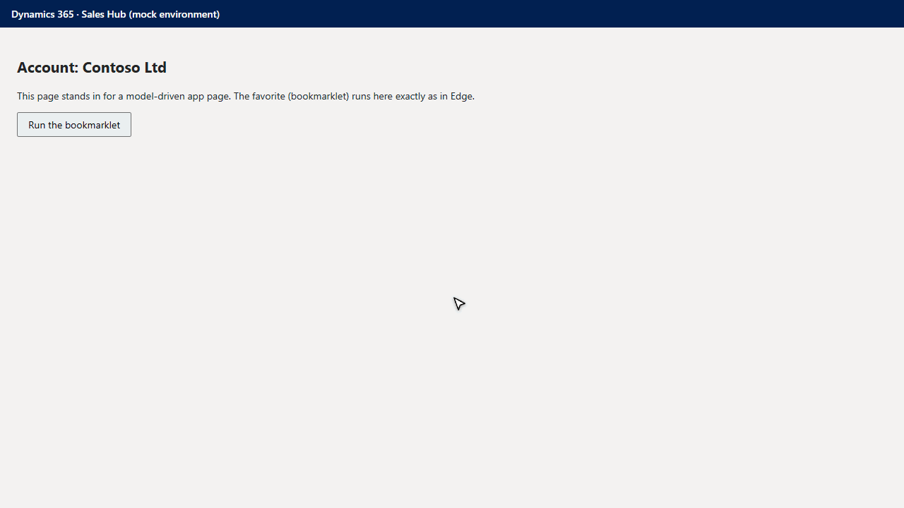
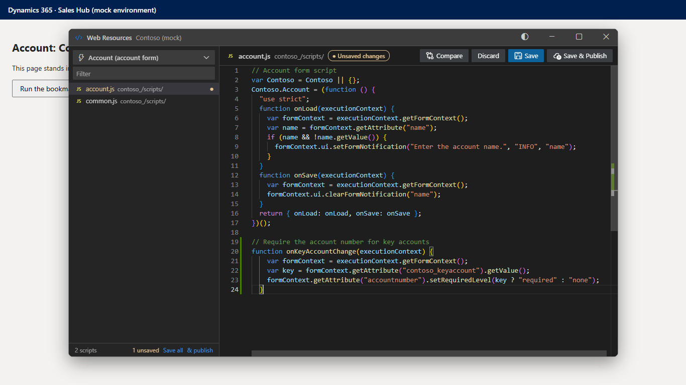
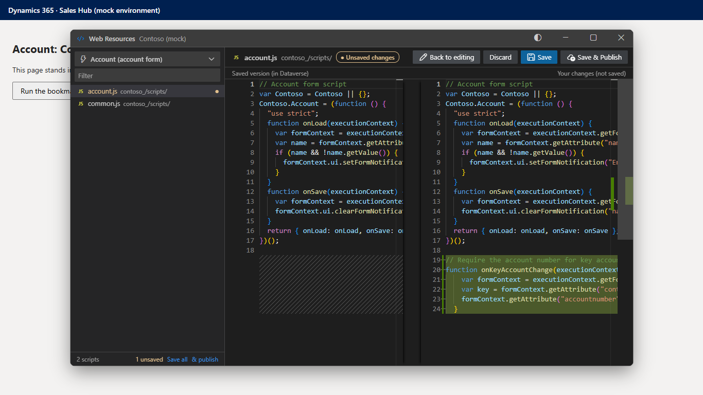

# Web Resources Manager

A bookmarklet for Microsoft Dataverse (Dynamics 365 and Power Apps) to **edit the JavaScript of a form, right on the
form**. Click it on a form: that form's scripts are listed and the first one opens, in Visual Studio Code's editor
with its colours. Change it, see your changes side by side, then **Save** or **Save & Publish**. Not on a form? Pick a
solution, or all web resources. It is inspired by the XrmToolBox
[Web Resources Manager](https://github.com/MscrmTools/MsCrmTools.WebResourcesManager) plugin by MscrmTools, and
takes its everyday script editing into the browser: nothing to install, and a check that nobody changed a file before
it is saved. It is not affiliated with that plugin.



The same demo as a [video (MP4)](docs/gallery/WebResourcesManager-demo.mp4).

| Item | Value |
| --- | --- |
| Tool | A bookmarklet: a favourite whose address is a small program. On the favourites bar it is named *Web resources*. Version 1.0.0 |
| Runs on | Any page of a Dataverse environment (`https://<org>.crm.dynamics.com/…`): best on a form of a model-driven app. Also an environment's pages in the maker portal ([make.powerapps.com](https://make.powerapps.com)). With your own sign-in |
| Browser | Microsoft Edge (Chrome works too) |
| Link size | About 1.6 million characters (Edge accepts up to about 2 million): the editor is compressed inside the link. Nothing is ever downloaded from anywhere else |
| Installs in the environment | Nothing: no solution, no app registration, no server code |
| Editor | [Monaco](https://microsoft.github.io/monaco-editor/), the editor of Visual Studio Code: its keys, find and replace (Ctrl+F, Ctrl+H), multi-cursor, folding, IntelliSense for the Xrm client API |
| License | [MIT](LICENSE). Third-party notices in [docs/THIRD-PARTY-NOTICES.md](docs/THIRD-PARTY-NOTICES.md) |

> **Safe on a shared environment.** Before every save the manager reads the script again: if someone saved a change
> after you opened it, nothing is overwritten. You see their version beside yours and choose. Scripts open in their
> **latest saved** version (not the published one), publishing tells you when it would also make someone else's saved
> change live, and your unsaved edits are kept in the browser, so a reload or a crash loses nothing.



## Install

1. Open [Install Web Resources Manager.html](Install%20Web%20Resources%20Manager.html) in Edge (download it first).
2. Show the favourites bar (Ctrl+Shift+B) and drag the blue **Web resources** button onto it.

Or create a favourite named **Web resources** and paste the whole content of
[dist/wrm.bookmarklet.txt](dist/wrm.bookmarklet.txt) as its URL (it starts with `javascript:`; paste it in one go).
To update, replace the favourite's URL (or drag the new button over it): unsaved changes and settings are kept.

## Use

1. **Open a form** in your app (an account, a case…) and click **Web resources** on the favourites bar. The scripts the
   form loads are listed on the left, in the order the form loads them, and the first one opens: they are read
   directly, without waiting for the list of every web resource in the environment.
   Not on a form? Click **Choose a solution…** (or **All web resources**): its scripts are listed. The choice is
   remembered for next time. The box at the top of the list switches between this form, a solution and all.
2. **Edit.** As soon as you change something it shows: an orange **Unsaved changes** badge above the editor, a dot
   next to the script in the list, the count at the bottom of the list, and coloured bars beside the changed lines.
3. **Compare** shows the saved version beside your changes; as in VS Code you keep editing on the right (Ctrl+S saves
   there too), and the arrows (Alt+F5, Shift+Alt+F5) step through the changes. A script saved but not published yet
   compares the published version with the saved one; with both, a list chooses which. **Back to editing** returns.
   **History** lists the versions this browser kept of the script (each save and publish, and what each one
   replaced): pick one to compare it, **Restore this version** puts it back as unsaved changes, and Save & Publish
   then undoes a publish. The versions stay in this browser only (the last 30 of each script).
4. **Save** (Ctrl+S) saves to Dataverse: users don't get it yet, and the badge says **not published**.
   **Save & Publish** (Ctrl+Shift+S) saves and publishes: users get it the next time they open the form. When the
   script is saved and only waits to be published, the button says **Publish**. **Discard** throws your changes away
   (after asking; **Undo** in the message that follows brings them back). With several scripts changed, **Save all** at the
   bottom of the list saves them together.
5. **The window** opens over the page, which stays usable beside it: drag it by its title bar, resize it by its
   edges, and **□** (or a double-click on the title bar) maximizes it to fill the page. It opens where you left it.
   **–** hides the manager (click the bookmark or the floating button to come back, as you left it); **×** closes it.
   Unsaved changes stay in the browser either way. The half-circle button in the header switches between the dark
   and the light theme (VS Code's Dark+ and Light+), and the choice is remembered. While the first scripts are read,
   a moving bar shows in the middle.
6. **⋯** (beside Save & Publish): **New script** (created in Dataverse, in the solution listed, when you save it),
   **Format document**, **Minify**, **Download**, **Replace with a file** (as unsaved changes), **Copy name**,
   **Open in a new tab** (the published version), and **Forms that load it**.



### If someone else changed the script

When you save, the manager reads the script again first. If someone saved it after you started editing, nothing is
written: the badge turns red (**Changed by …**) and **Compare and choose** shows their version beside yours. Take
theirs, keep yours (saved over theirs after you confirm), or combine both on the right and save that.

### What gets underlined

Only what breaks a script is underlined in red: syntax errors, and the 2011 OData endpoint
(`OrganizationData.svc`), which no longer exists. `Xrm.Page` is **not** underlined: Microsoft deprecated it in favour
of the form context (`executionContext.getFormContext()`), but it still works, and older scripts use it everywhere.

### Keys

| Keys | Action |
| --- | --- |
| Ctrl+S / Ctrl+Shift+S | Save / Save & Publish |
| Ctrl+F / Ctrl+H | Find / replace in the script |
| Ctrl+Space | IntelliSense (formContext, Xrm.WebApi… and the form's columns) |
| F12 / Ctrl+Click, Alt+F12 | Go to the definition (also in the form's other scripts: `Contoso.Common.formatPhone`), peek at it |
| Shift+F12 | Find all references (in the form's scripts and those opened) |
| F2 | Rename a local variable, parameter or inner function everywhere it is used (global names are left alone: the form's event handlers name them) |
| Ctrl+Shift+O / Ctrl+G | Go to a function / a line |
| Shift+Alt+F / Ctrl+K Ctrl+F | Format the script / the selection |
| F1 | The editor's commands |
| Ctrl+K Ctrl+C / Ctrl+K Ctrl+U | Comment / uncomment lines |
| Ctrl+Z / Ctrl+Y | Undo / redo |

## Safety

* **Reads before every write.** A save re-reads the server's saved version and writes only if nothing you changed was
  changed by someone else; then it reads again and checks the stored content is exactly what was sent.
* **Latest saved, not published.** Scripts open from `RetrieveUnpublished`, the version the form designer and the
  maker portal edit.
* **Publishing someone else's work is never silent.** Before publishing, saved changes by other people are named, and
  in a Production environment publishing always asks first.
* **Write guards.** Saving content that became empty or less than a quarter of its size asks first; managed scripts
  that don't allow changes are read-only; the organization's size limit is checked before sending.
* **Unsaved edits in the browser**, per environment (IndexedDB of the environment's own address). They never leave the
  browser, and come back after a reload or a crash.
* **Requests** go only to the environment's Web API, with your session.

## Troubleshooting

| Message or symptom | What to do |
| --- | --- |
| Nothing happens when clicking the favourite | The URL was cut when pasting: paste the whole `dist/wrm.bookmarklet.txt` again |
| "Your Dynamics session has expired" | Reload the page, sign in, click the favourite again. Unsaved changes come back |
| "Another customization operation … is running" | A publish or an import holds the environment's lock; the manager retries for about two minutes |
| A script opens read-only | It belongs to a managed solution that doesn't allow changing it |
| A form library is greyed out in the list | The form loads it, but there is no web resource of that name (a platform library) |
| "Your security roles don't allow changing web resources" | Ask for the *Write Web Resource* privilege (System Customizer has it) |

## How it works

The favourite is a small loader with the whole manager inside, compressed (deflate) and base85-encoded. On click it
unpacks the code with the browser's `DecompressionStream` and runs it on the page. That code creates a window over
the page, a frame of the page's own origin, and runs the manager inside it: requests carry the page's session cookie exactly as
the app's own do, while the manager's styles, keys and editor stay apart from the page. The form is taken from the
page's client API (`Xrm.Utility.getPageContext()`), and its scripts from its latest saved form XML. See
[docs/ARCHITECTURE.md](docs/ARCHITECTURE.md) for the code map.

## Compared with the XrmToolBox plugin

| | XrmToolBox Web Resources Manager | Web Resources Manager (this) |
| --- | --- | --- |
| Install | XrmToolBox + plugin, connection setup | A favourite; your browser session |
| A form's scripts | Find them in the solution | Open the bookmark on the form: listed at once |
| Opens | The published version (unpublished saves by others are replaced) | The latest saved version |
| Concurrency | Manual version check (turned off by "force update") | Re-read before every save, verify after, never overwrite; compare and choose |
| Encoding | BOM check cut the first `"` of files; images exported as text | Byte-exact: BOM and line endings kept |
| Editor | Scintilla | VS Code's editor (Monaco) with Xrm IntelliSense |
| Changes | Pending updates list | Badge, list marks, change bars and side-by-side compare |
| Publishing | Publishes without telling whose changes go live | Names others' changes first, verifies after |

## Development

```
npm install
npm run build        # dist/wrm.bookmarklet.txt, dist/wrm.min.js and the install page (zopfli: slower, smaller)
npm run build:fast   # quicker builds while working
npm run check        # TypeScript
```

The screen is `src/ui/simple.tsx`; see [docs/ARCHITECTURE.md](docs/ARCHITECTURE.md) for the map of the code.
